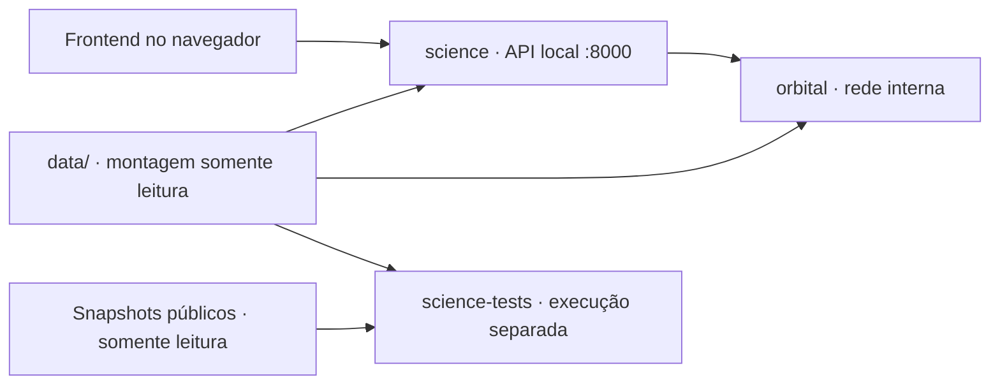

# Orbital

## Instalar e abrir no Windows

**[Baixar instalador Orbital 0.1.2 para Windows x64 (.exe)](https://github.com/DunDao0/Orbital/releases/download/v0.1.2/Orbital-0.1.2-Setup-x64.exe)** · [Ver versões disponíveis](https://github.com/DunDao0/Orbital/releases)

Esta é uma versão preliminar, em desenvolvimento. O instalador inclui o código do Orbital; a primeira abertura precisa de internet para baixar os componentes adicionais.

**Baixe o arquivo `.exe`, abra-o e clique em Instalar.** O assistente coloca os arquivos na pasta escolhida e cria atalhos. Você não precisa extrair um ZIP, saber programar nem digitar comandos.

### O que você precisa ter no computador

- **Windows 10 ou 11 de 64 bits, em um computador com processador Intel ou AMD.** O instalador atual não atende Windows ARM, macOS ou Linux.
- **Um navegador de internet com suporte a gráficos 3D (WebGL).** É nele que você vai visualizar o Orbital. Você pode usar o navegador que já tem, desde que ele ofereça esse suporte.
- **Conexão com a internet durante a primeira instalação.** O instalador precisa baixar programas e dados adicionais; mantenha a conexão até a preparação terminar.
- **Uma pasta sua e vazia para instalar o projeto.** O assistente já sugere `%LOCALAPPDATA%\Programs\Orbital\0.1.2`, dentro do seu perfil do Windows. Você pode manter essa escolha.
- Pelo menos **4 GB livres como margem inicial** para downloads, dependências e temporários; esse valor não é um consumo máximo garantido.

### Preciso instalar Python, Node.js, Git ou Docker antes?

**Não. Para o procedimento abaixo, o instalador do Orbital baixa e prepara os componentes necessários automaticamente:**

- **Node.js:** executa a parte do programa que apresenta a interface no navegador.
- **Python:** executa os cálculos astronômicos.
- **Bibliotecas e dados astronômicos:** incluem os componentes usados pelos dois programas, os catálogos e os arquivos necessários aos cálculos.

Você não precisa procurar esses instaladores na internet nem escolher versões. Eles ficam preparados dentro da pasta do Orbital, sem substituir instalações de Python ou Node.js que você já tenha. **Git e Docker não são necessários para esse modo de uso.**

O instalador usa o **Windows PowerShell**, que já vem incluído no Windows 10/11. Não é necessário instalar PowerShell 7 nem executar como administrador. Se o computador for gerenciado por uma empresa e bloquear scripts, consulte o responsável por ele.

O Orbital usa os endereços locais nas portas `3000` e `8000`. Você não precisa configurar o roteador nem abrir portas para a internet. Se outro programa já estiver usando essas portas, aparecerá uma mensagem de erro; veja a seção **Se não abrir**.

### Primeira instalação, passo a passo

1. Clique em **[Baixar instalador Orbital](https://github.com/DunDao0/Orbital/releases/download/v0.1.2/Orbital-0.1.2-Setup-x64.exe)**. Não é necessário criar uma conta no GitHub.
2. Abra a pasta **Downloads** e dê dois cliques em **`Orbital-0.1.2-Setup-x64.exe`**.
3. No assistente, mantenha a pasta sugerida ou escolha uma pasta vazia. Deixe marcada a opção de criar um atalho na área de trabalho, se desejar.
4. Clique em **Instalar**. Com **Abrir o Orbital após a instalação** marcado, a preparação começa automaticamente. Se desmarcar essa opção, abra depois pelo menu **Iniciar → Orbital 0.1.2 → Abrir Orbital**.
5. Uma janela de mensagens mostra o progresso dos downloads. Mantenha a internet conectada e aguarde as quatro etapas; não feche a janela durante a preparação. A primeira abertura pode levar vários minutos. Não é preciso instalar Python, Node.js, Git ou Docker separadamente.
6. Quando aparecer **`Pronto: http://127.0.0.1:3000`**, o navegador será aberto. Se ele não abrir automaticamente, acesse [Orbital local](http://127.0.0.1:3000).
7. Entre no **Atlas** e abra a [Terra](http://127.0.0.1:3000/atlas/earth) para conferir a interface. Observe os avisos científicos: o site pode abrir mesmo quando uma operação específica estiver indisponível por cobertura de dados.

O endereço `127.0.0.1` aponta para o próprio computador. Esse procedimento inicia o projeto localmente e não publica o site na internet.

O `.exe` ainda não possui assinatura digital; o Windows pode mostrar **editor desconhecido** ou um aviso de reputação. Confira se o arquivo veio da release oficial de `DunDao0/Orbital`. Em computadores gerenciados, consulte o responsável se a execução for bloqueada.

**Alternativa em ZIP:** [baixe o pacote 0.1.2](https://github.com/DunDao0/Orbital/releases/download/v0.1.2/Orbital-0.1.2-Windows-x64.zip), escolha **Extrair Tudo** e abra **`Instalar-e-Abrir.cmd`** na pasta extraída. A opção **Code → Download ZIP** também continua disponível para obter a branch `main`, que pode conter alterações posteriores à release. `SHA256SUMS.txt` permite conferir a integridade dos downloads; não precisa ser executado.

### O que acontece durante a preparação

| Etapa | O que o instalador faz |
| --- | --- |
| Runtimes | Prepara Node.js 22.23.2, o gerenciador `uv` 0.9.2 e Python 3.12.12 nas versões declaradas em `scripts/windows/runtimes.json`. Os ZIPs de Node.js e `uv` são verificados por SHA-256. |
| Backend | Cria um ambiente Python próprio e instala as dependências do lock Windows com verificação de hashes. |
| Frontend | Instala as dependências a partir de `package-lock.json`, incluindo as necessárias à execução local. |
| Dados | Prepara e verifica os catálogos e kernels científicos conforme os manifestos aprovados; arquivos ausentes podem exigir download. |

Os runtimes, o ambiente Python, o estado e os logs ficam em **`.orbis/`**; as dependências da interface ficam em **`node_modules/`** e os dados científicos de trabalho em **`data/`**. São arquivos locais, excluídos do Git. O instalador não altera o `PATH` global nem instala Python ou Node.js globalmente.

Depois das verificações, um supervisor inicia a interface na porta `3000` e a API Python na porta `8000`, ambas em loopback. Nesse fluxo Windows, a API roda diretamente pelo Python; os contêineres `science` e `orbital` descritos adiante pertencem ao fluxo alternativo com Docker.

### Abrir novamente, parar e atualizar

| Ação | Como fazer |
| --- | --- |
| Abrir novamente | Use o atalho **Abrir Orbital** no menu Iniciar ou o atalho da área de trabalho. Na versão ZIP, execute **`Instalar-e-Abrir.cmd`**. A preparação existente é reutilizada. |
| Encerrar | Use **Parar Orbital** no menu Iniciar ou **`Parar-Orbital.cmd`** na pasta instalada. Fechar apenas a aba do navegador não encerra a interface e a API. |
| Usar uma versão nova do projeto | Pare a instância atual e baixe o instalador da versão desejada em [Releases](https://github.com/DunDao0/Orbital/releases). Cada versão usa uma pasta própria. Não copie `.orbis` de uma instalação anterior nem mova a pasta enquanto estiver em execução. |
| Desinstalar | Abra **Configurações → Aplicativos**, encontre **Orbital 0.1.2** e escolha **Desinstalar**, ou use **Desinstalar Orbital** no menu Iniciar. Downloads, dados, logs e arquivos modificados são preservados na pasta, informada ao final. |

O comando de parada solicita o encerramento dos processos pertencentes àquela instância. Ele não encerra programas de terceiros para liberar portas. O launcher também não faz `git pull`: abrir novamente a mesma pasta não baixa automaticamente alterações do código.

Se preferir usar um terminal, abra o PowerShell na pasta instalada ou extraída e execute:

```powershell
# Preparar o ambiente e abrir o Orbital
.\Instalar-e-Abrir.cmd

# Executar quando quiser encerrar os serviços dessa instalação
.\Parar-Orbital.cmd
```

O [manual completo](docs/instalacao-windows.md) inclui as opções `-PrepareOnly`, `-NoBrowser` e `-Action Status`, além de diagnóstico e reparo.

### Se não abrir

| Sintoma | Próximo passo |
| --- | --- |
| Porta 3000 ou 8000 ocupada | Se for outra instância do Orbital, use o `Parar-Orbital.cmd` da pasta correspondente. Se for outro programa, encerre-o pelo procedimento dele. |
| Falha de download ou falta de espaço | Confira a conexão e o espaço disponível; depois execute novamente o launcher. |
| Falha de checksum ou integridade | Preserve a mensagem e consulte os logs. Não altere os hashes para forçar a instalação. |
| O navegador não abriu, mas apareceu “Pronto” | Abra [http://127.0.0.1:3000](http://127.0.0.1:3000) manualmente. |
| Site aberto com aviso científico | Confira [prontidão da API](http://127.0.0.1:8000/api/health/ready) e [capacidades](http://127.0.0.1:8000/api/capabilities). Certas datas podem estar fora da cobertura ou depender de previsões IERS vencidas; reinstalar não atualiza automaticamente a política científica. |
| Bloqueio pelo Windows, antivírus ou política da empresa | Confirme a origem do download e consulte o responsável pela máquina. O instalador `.exe` ainda não possui assinatura digital. |

Os registros ficam em **`.orbis\logs`**. Ao solicitar ajuda, informe a etapa que falhou e a mensagem apresentada. O `.exe` foi compilado e teve instalação, atalhos e desinstalação testados automaticamente nesta estação. A preparação completa dos componentes também foi exercitada localmente. A interação manual com o assistente e a compatibilidade com outras máquinas ainda precisam de validação. Veja o [manual do instalador executável](docs/instalador-exe-windows.md).

## Sugerir melhorias e contribuir

Você pode consultar o código, baixar o projeto, abrir uma [sugestão ou relato de problema](https://github.com/DunDao0/Orbital/issues/new/choose) e propor código por uma pull request a partir de um fork. Para enviar propostas pelo GitHub, use sua conta na plataforma.

**A versão oficial continua sob controle de @DunDao0.** Contribuidores não recebem acesso de escrita. A branch `main` exige revisão do responsável pelos arquivos para propostas de colaboradores, e novos commits invalidam a aprovação anterior. Apenas o proprietário integra as contribuições ou faz suas próprias alterações; o merge automático permanece desabilitado.

Modificar uma cópia ou um fork não altera o repositório oficial. Leia o [guia de contribuição](https://github.com/DunDao0/Orbital/blob/main/CONTRIBUTING.md) para conhecer o processo, os testes e os contratos científicos que devem ser preservados.

## Resumo

**Orbital** é uma plataforma científica interativa em desenvolvimento que reúne exploração do Sistema Solar em 3D, simulação de movimento orbital, atlas planetário e consultas do céu a partir de um observador na Terra. A proposta é conectar a experiência visual aos dados e cálculos que a sustentam, permitindo explorar corpos celestes, compreender suas relações espaciais e consultar informações astronômicas com contexto físico explícito.

A plataforma combina estados de referência obtidos de efemérides, catálogos de estrelas e satélites naturais, limites oficiais de constelações e integração gravitacional de múltiplos corpos. A exploração abrange tanto a visão do Sistema Solar quanto a perspectiva de um observador definido por latitude, longitude, elevação e instante UTC. Os recursos de céu local e análise de eclipses dependem do backend científico e da disponibilidade e validade das fontes necessárias.

O desenvolvimento prioriza rastreabilidade e clareza: cada resultado deve conservar sua origem, época, referencial e método, distinguindo dados de referência, resultados de simulação e adaptações visuais. Ajustes de câmera, tamanho e escala facilitam a exploração sem modificar os valores físicos. Quando os dados estão ausentes, vencidos ou fora de cobertura, a aplicação deve informar essa condição, com limites de precisão explícitos.

O projeto parte da base **Orbis Scientia**, nome ainda presente em módulos e na documentação técnica, e está em desenvolvimento e validação locais. Seu objetivo é servir como ambiente de exploração, estudo e investigação computacional de fenômenos astronômicos; a visualização e os cálculos disponíveis não representam, por si só, uma ferramenta operacional de previsão validada.

## Summary

**Orbital** is an interactive scientific platform under development that brings together 3D Solar System exploration, orbital motion simulation, a planetary atlas, and sky queries from an observer's location on Earth. It aims to connect the visual experience with the underlying data and calculations, enabling users to explore celestial bodies, understand their spatial relationships, and examine astronomical information with explicit physical context.

The platform combines ephemeris-based reference states, star and natural satellite catalogs, official constellation boundaries, and gravitational integration of multiple bodies. Exploration spans both a Solar System view and the perspective of an observer defined by latitude, longitude, elevation, and a UTC instant. Local sky and eclipse analysis features depend on the scientific backend and on the availability and validity of the required data sources.

Development prioritizes traceability and clarity: each result should retain its source, epoch, reference frame, and method, distinguishing reference data, simulation results, and visual adaptations. Camera, size, and scale adjustments support exploration without modifying physical values. When data is missing, outdated, or outside its coverage, the application should report that condition and make precision limits explicit.

The project builds on **Orbis Scientia**, a name still used in modules and technical documentation, and is undergoing local development and validation. Its goal is to provide an environment for exploration, study, and computational investigation of astronomical phenomena; the available visualizations and calculations do not, by themselves, constitute a validated operational prediction tool.

## Estado do projeto

Em desenvolvimento local. Este repositório reúne o código-fonte, os testes, a documentação e os catálogos públicos usados pela interface. Dependências, ambientes virtuais e kernels de trabalho não estão incluídos no Git; o instalador Windows prepara esses componentes. O fluxo manual e o Docker exigem a preparação descrita em suas respectivas instruções.

## Atualização de 20/10/2026

- **Instalação no Windows:** `Instalar-e-Abrir.cmd` prepara runtimes, dependências e dados em um ambiente isolado na pasta do projeto; `Parar-Orbital.cmd` encerra os processos dessa instância. A primeira instalação precisa de internet. O fluxo não exige instalar Git ou Docker e não é um executável assinado nem um pacote offline completo. Consulte [Instalação no Windows](docs/instalacao-windows.md) e [evidências e limites do instalador](docs/installer-validation-2026-10-20.md).
- **Atlas e navegação:** correções de transição da câmera, geometria das órbitas desenhadas, controles do horizonte, shaders, jornadas, projetos e formulários. Links usam navegação documental como mitigação de falhas verificadas no roteamento do Vinext, preservando clique, teclado e abertura em outra aba. As adaptações visuais não modificam o estado físico. Detalhes em [Correções do frontend](docs/frontend-corrections-2026-10-20.md).
- **Backend científico:** verificação estrita de kernels e catálogos, cache vinculado ao conteúdo aprovado, contratos de capabilities e erros mais rigorosos, preservação da precisão temporal e regressões de geometria de eclipses e constelações. Consulte [Correções do backend](docs/backend-hardening-followup-2026-10-20.md).
- **Manutenção IERS:** atualização controlada, com versões, hashes e políticas anteriores preservados em `backend/releases/iers-2026-10-20`. Os wheels permanecem locais e fora do Git. A validade temporal continua sendo verificada; a política atual limita o uso das previsões a 01/11/2026 UTC, sem desabilitar globalmente dados históricos válidos. Procedimento em [Manutenção dos dados](docs/backend-data-maintenance.md).
- **Execução e diagnóstico:** perfis de validação explícitos para Linux e Windows com CPython 3.12, benchmark de serviços e Compose com arquitetura Linux AMD64, limites configuráveis de CPU, RAM, PIDs, logs e armazenamento temporário. Há encerramento controlado e política de reinício; isso não implica capacidade de produção garantida nem cancelamento remoto de cálculos. Consulte [Capacidade e medições](docs/backend-capacity.md).
- **Integridade após baixar do GitHub:** os atributos Git preservam os bytes de catálogos, snapshots, manifestos, locks e políticas de manutenção verificados por hash. Isso evita que uma conversão automática de quebras de linha invalide dados aprovados. Na publicação, 37 arquivos foram comparados byte a byte com suas fontes.

Na preparação desta atualização, `npm.cmd test` aprovou o build e **107 testes** (31 Node/SSR/Worker e 76 TypeScript). A suíte Python local aprovou **371 testes**, com **8 ignorados** por ausência de SpiceyPy. TypeScript e lint também passaram. As execuções anteriores dos perfis completos, Docker e validação visual estão registradas nos documentos vinculados; não foram repetidas nem tratadas como nova evidência de runtime neste envio.

## Recursos em desenvolvimento

- **Sistema Solar em 3D:** exploração de corpos celestes, órbitas e escalas visuais.
- **Simulação orbital:** integração N-body com Velocity-Verlet e unidades físicas explícitas.
- **Atlas planetário:** navegação e inspeção visual de planetas e da Terra.
- **Céu local:** consultas para um observador definido por localização, elevação e instante UTC.
- **Constelações e catálogos:** referências de estrelas, satélites naturais e limites oficiais de constelações.
- **API científica:** estados de referência, catálogos e operações dependentes do backend científico.

A disponibilidade de cada operação depende das fontes de dados, da cobertura temporal e dos serviços locais necessários.

## O que mudou e por quê

O estado publicado reúne a evolução da visualização, dos contratos científicos e da execução do backend. As principais mudanças são:

| Mudança | Motivo e efeito esperado |
| --- | --- |
| Atlas 3D com navegação, foco e escalas visuais explícitas | Permitir explorar corpos com tamanhos e distâncias muito diferentes sem alterar posições, velocidades ou parâmetros físicos. A amplificação visual continua identificada como recurso de leitura. |
| Catálogo de constelações e observação a partir da Terra | Separar a consulta de regiões e estrelas catalogadas daquilo que está acima do horizonte de um observador, em um local e horário específicos. Uma posição de catálogo não é uma garantia de visibilidade. |
| Contratos de API validados e disponibilidade por operação | Impedir que JSON incompleto, dados incompatíveis ou um serviço indisponível sejam tratados como resultados científicos válidos. A interface distingue referência fixa, cálculo nativo e indisponibilidade. |
| Preservação da última consulta confirmada e cancelamento de respostas antigas | Evitar que uma falha apague o contexto ou que uma resposta atrasada substitua a consulta mais recente. Resultados anteriores mantêm sua identidade de local e instante. |
| Verificação de idade, cobertura e integridade dos dados IERS | Evitar cálculos de orientação da Terra com tabelas vencidas, ausentes ou fora de cobertura. A aplicação informa a limitação em vez de desativar a verificação. |
| Conversão temporal comum aos leitores DE442s e SPICE | Corrigir a possibilidade de consultar instantes físicos diferentes conforme o leitor instalado. UTC é interpretado uma vez pelo Astropy/ERFA; os dois leitores recebem o mesmo instante TDB. Isso é especialmente importante para datas anteriores a 1972. |
| Separação entre os serviços `science` e `orbital` | Isolar responsabilidades, dependências e falhas, mantendo os contratos HTTP. O encaminhamento preserva o resultado orbital, suas unidades, época, referencial e procedência. |
| Imagens Docker, dependências fixadas e testes com SPICE | Tornar o ambiente científico mais controlado e verificar caminhos que a instalação Python local sem SpiceyPy não consegue exercitar. |

Essas mudanças não introduzem um novo modelo físico nem garantem maior precisão por si só. Permanecem o Velocity-Verlet, os limites dos kernels, as restrições de cobertura e as limitações dos cálculos de eclipses. A correção temporal está detalhada em [Política temporal](docs/ephemeris-time-policy.md).

## Por que usamos Docker

Docker é uma alternativa para executar e validar o backend em um ambiente controlado. **Não é necessário para o fluxo Windows por `Instalar-e-Abrir.cmd`.** Escolha um fluxo por vez: a API direta e o serviço Docker `science` usam, por padrão, a mesma porta local `8000`.

O backend depende de uma combinação específica de Python, bibliotecas numéricas, tabelas de tempo e leitores de efemérides. Diferenças entre a instalação Windows e um ambiente Linux podem mudar a disponibilidade dessas dependências e os caminhos de cálculo exercitados. Docker empacota esse ambiente separadamente da máquina de desenvolvimento e permite executar os serviços e os testes com versões conhecidas.

O Dockerfile atual fixa a imagem base `python:3.12-slim` por digest e instala versões exatas com hashes a partir de `backend/locks/`. O build exige os artefatos binários aprovados; uma arquitetura sem esses artefatos pode exigir a preparação e validação de novos locks. O build normalmente precisa de internet, mas as consultas científicas não atualizam kernels ou tabelas IERS automaticamente.

Docker também permite executar os dois serviços em processos separados, restringir o acesso aos dados e testar com SpiceyPy sem modificar a `.venv` do Windows. Ele não fornece CPU ou memória adicionais: os contêineres usam os recursos do computador. Aumentar a quantidade de workers aumenta o paralelismo possível e o consumo de memória; não acelera automaticamente uma integração isolada.

### O que há em cada contêiner

| Serviço do Compose | Conteúdo da imagem | Responsabilidade e acesso |
| --- | --- | --- |
| `science` — target `runtime` | Python 3.12, pacote do backend, FastAPI/Uvicorn, Astropy, NumPy, SciPy, HTTPX e tabelas IERS da dependência fixada. Não instala SpiceyPy. | Calcula céu topocêntrico, observatório de constelações e busca local de eclipses. Encaminha as rotas orbitais para `orbital`. É o único serviço com porta publicada no host, por padrão `127.0.0.1:8000`. |
| `orbital` — target `orbital` | Herda a base `runtime` e acrescenta SpiceyPy 7.0.0 com dependências verificadas. | Fornece estados DE442s, integração orbital e catálogos. Recebe chamadas pela rede interna do Docker, sem porta publicada no host. |
| `science-tests` — target `science-tests` | Herda a imagem orbital, incluindo SPICE, e adiciona pytest, testes científicos e HTTP, ensaios de carga, ferramentas de verificação e inventário de dados. | Executa o gate de validação sob o perfil `tests`. Não sobe com o uso normal de `docker compose up`; opera sem rede externa e sem publicar portas. |

Os targets compartilham o pacote Python, mas a função selecionada por `ORBIS_SERVICE_ROLE` define as rotas e os serviços ativos. Portanto, separar os contêineres não significa duplicar os cálculos: `science` encaminha as operações orbitais e preserva a resposta recebida.



Esse fluxo representa as operações nativas quando o frontend está configurado para acessar a API. O Worker continua capaz de servir referência fixa e catálogos; operações nativas indisponíveis permanecem explicitamente indisponíveis.

### Dados, isolamento e o que fica fora das imagens

- **Dados científicos de trabalho:** `./data` é montado em `/app/data` como somente leitura. Os kernels e demais arquivos devem existir na máquina; não são incorporados às imagens nem enviados ao Git. O inventário `backend/data-inventory.json` registra os arquivos e hashes esperados pelo gate.
- **Tabelas IERS:** vêm da versão fixada de `astropy-iers-data` instalada na imagem. A política em `backend/src/astro_system/iers-policy.json` permite verificar sua integridade. Estarem instaladas não garante cobertura válida para qualquer data consultada.
- **Dados dos testes:** `science-tests` recebe também `public/scientific` e `public/reference-snapshot.json`, ambos montados somente para leitura. O gate compara os dados disponíveis com o inventário aprovado.
- **Frontend:** React, Three.js e o servidor de desenvolvimento não estão nesses contêineres. O frontend continua sendo iniciado separadamente com `npm.cmd run dev`.
- **Arquivos locais:** `.venv`, `node_modules`, logs, caches, credenciais e o ZIP de handoff não compõem as imagens do backend. O contexto de build usa uma lista explícita de arquivos permitidos.

Os serviços rodam como usuário sem privilégios de administrador, com sistema de arquivos somente leitura, capabilities removidas e `/tmp` temporário. A rede `computation` é interna; `science` também usa a rede `local_entry` para a entrada pelo host. Essa rede adicional permite saída, portanto a política de não baixar dados científicos durante as consultas é aplicada pelo código, não por um bloqueio geral de rede.

O healthcheck confirma que o processo responde. A rota `/api/health/ready` informa a disponibilidade das dependências, mas uma consulta ainda pode ser rejeitada por cobertura temporal ou dados IERS inválidos. A configuração é local e não inclui implantação pública, distribuição automática entre máquinas ou uma fila de cálculos.

### Como executar com Docker

Requer Docker com motor Linux ativo, Compose e os dados científicos preparados. Antes do build, consulte [Fontes de dados](docs/data_sources.md), as instruções técnicas abaixo e [Serviços científicos em Docker](docs/docker-scientific-services.md). Clonar o repositório não baixa o diretório `data/`.

Na raiz do repositório, para construir e iniciar os serviços:

```powershell
docker compose config --quiet
docker compose build science orbital
docker compose up -d science orbital
docker compose ps
Invoke-RestMethod http://127.0.0.1:8000/api/health/ready
```

Inicie o frontend separadamente, após instalar suas dependências:

```powershell
npm.cmd install
npm.cmd run dev
```

Não execute a API Python direta e o contêiner `science` simultaneamente na mesma porta. `SCIENCE_PORT` permite escolher outra porta local; isso exige ajustar também a conexão usada pelo frontend. O backend direto permanece disponível como alternativa ao Docker, conforme as instruções técnicas abaixo.

Para executar o gate Docker, incluindo testes com SPICE:

```powershell
docker compose --profile tests build science-tests
docker compose --profile tests run --rm --no-deps science-tests
```

O runner verifica versões instaladas, integridade IERS, inventário científico e consistência das dependências antes de executar `tests` e `validation`. O gate rejeita testes ignorados. Os ensaios de carga verificam repetibilidade e resultados finitos em cenários delimitados; não constituem garantia de capacidade em produção.

Para encerrar os serviços locais:

```powershell
docker compose stop science orbital
```

### Validação e limites da evidência

Na preparação do primeiro envio do código, em 22/09/2026, o build e os testes do frontend, TypeScript e lint passaram. A suíte Python local terminou com **80 testes aprovados e 5 ignorados**, estes por ausência do SpiceyPy na `.venv` Windows. Não houve deploy nem nova validação visual nessa publicação.

Os registros em [Serviços científicos em Docker](docs/docker-scientific-services.md) descrevem execuções anteriores dos contêineres e testes com SPICE. São evidências de suas respectivas revisões, não uma nova execução do Docker nesta atualização do README. Alguns trechos históricos desse documento precedem os locks; para a configuração atual de build, consulte [Dockerfile](backend/Dockerfile), [Compose](docker-compose.yml) e [locks](backend/locks/).

## Compromissos científicos

- Preservar posições, velocidades, parâmetros gravitacionais, época e referencial fornecidos pelo cálculo científico.
- Manter ajustes de câmera, tamanho e escala exclusivamente na camada visual.
- Identificar a origem dos dados e distinguir estados de referência de simulações.
- Não apresentar elementos médios de catálogo como posições observadas de luas.
- Informar dados ausentes, vencidos ou fora de cobertura, sem inventar resultados substitutos.

## Tecnologias

| Camada | Tecnologias |
| --- | --- |
| Interface e visualização | React, TypeScript e Three.js |
| Ferramentas do frontend | Vite e Vinext |
| Backend científico | Python, FastAPI e Astropy |
| Efemérides e referências | JPL DE442s/SPICE, Gaia DR3 e limites de constelações IAU |

## Limitações atuais

O projeto não deve ser interpretado como um previsor operacional validado. Cálculos de eclipses têm limitações de método e precisão; operações de observação dependem da validade das tabelas IERS e da cobertura das efemérides. Uma representação visual não comprova precisão física.

O desenvolvimento e a validação atuais são locais. Consulte as instruções técnicas abaixo e a documentação em `docs/` para preparar o ambiente e os dados antes da execução.

## Próximas etapas

- Manter a validação de frontend, tipos e backend a cada evolução.
- Ampliar a verificação visual e a documentação de reprodução em outras máquinas.
- Evoluir os recursos respeitando a cobertura dos dados e os limites científicos documentados.

---

## Orbis Scientia

### Instalação fácil no Windows

O fluxo recomendado para abrir o projeto no Windows está em [Instalar e abrir no Windows](#instalar-e-abrir-no-windows), no início deste README. As instruções seguintes destinam-se à preparação manual do ambiente de desenvolvimento.

Scientific Solar-System workbench with a traceable reference-state pipeline, a real fixed-step N-body engine, an offline JPL/GAIA data bundle and a technical interactive viewer. It favours explicit limits over plausible-looking fabricated motion.

### What runs in this build

- Browser planetarium with a real DE442s state snapshot at `2026-08-05T00:00:00`, a client-side Velocity-Verlet N-body switch, object inspection, model labels and scale warning.
- DE442s kernel pipeline, SHA-256 manifests, type-2 SPK reader fallback and strict no-extrapolation behavior.
- Searchable JPL satellite catalog: 460 records (Earth 1, Mars 2, Jupiter 115, Saturn 291, Uranus 30, Neptune 16, Pluto 5). Mean elements are catalog-only, never silently promoted to a precise visual ephemeris.
- Gaia DR3 browser-sized bright-star subset: 10,000 actual source records with proper motion and parallax fields.
- IAU 88-constellation offline guide catalogue, formal Roman–Delporte boundary geometry and an Earth local-observer route at `/atlas/earth/constellations`; cultural lines and unverified star names remain explicitly absent.
- Pure-Python scientific tests plus production frontend test.

### Quick start

```powershell
npm.cmd install
npm.cmd run dev
```

Open `http://localhost:3000`. The app is usable offline after the data bundle has been created; its reference viewer state is fixed at the exported epoch.

For the local API and high-level coordinate work, install the declared Python environment on a standard networked host:

```powershell
python -m venv backend/.venv
backend/.venv/Scripts/python.exe -m pip install -e "backend[dev]"
backend/.venv/Scripts/python.exe -m uvicorn astro_system.api.main:app --app-dir backend/src --host 127.0.0.1 --port 8000 --no-access-log
```

The bundled DE442s reader keeps the reference endpoints available without a
native SPICE binding. On hosts with a compatible compiler or wheel, install the
optional full-SPICE provider with `backend/.venv/Scripts/python.exe -m pip
install -e "backend[spice]"`.

### Scientific API contract

The hosted site includes a same-origin read-only API, so the reference viewer
does not depend on a hard-coded local address. It exposes the fixed exported
state and the generated catalogues:

- `GET /api/health`
- `GET /api/health/ready`
- `GET /api/capabilities`
- `GET /api/reference/state` (optional `bodies=Earth,Moon`; only the exported
  epoch is accepted by the Worker; FastAPI accepts the real DE442s coverage)
- `GET /api/catalogs/moons` (optional `primary`, `query`, `limit`)
- `GET /api/catalogs/stars` (optional `query`, `max_magnitude`, `limit`)
- `GET /api/catalogs/constellations`
- `POST /api/sky`, `POST /api/sky/constellations`,
  `POST /api/eclipses/local` and `POST /api/simulate` (native-only JSON)

The Worker explicitly returns `501 SCIENCE_SERVICE_UNAVAILABLE` for valid
dynamic methods when the native service is absent. `GET /api/sky` and
`GET /api/eclipses/local` remain deprecated compatibility routes;
`GET /api/simulate` is `405`. The Worker never substitutes an approximate
calculation.

The current workflow is local only: run the API on `127.0.0.1:8000` and the
frontend on `localhost:3000`. Do not publish the API port or create a tunnel.
Operation and security constraints are in
[`docs/local-scientific-service.md`](docs/local-scientific-service.md).

### Data update and validation

```powershell
python scripts/fetch_spice_data.py
$env:PYTHONPATH = (Resolve-Path backend/src).Path
python scripts/export_frontend_snapshot.py
python scripts/update_moon_catalog.py
python scripts/build_star_catalog.py
python scripts/update_constellations.py
python scripts/generate_offline_bundle.py
python scripts/validate_data_manifest.py
backend/.venv/Scripts/python.exe -m pytest backend/tests
python scripts/benchmark.py
npm.cmd test
npx.cmd tsc --noEmit
```

### Reference systems and precision

Internal N-body units are metres, seconds and m³/s². Kernel states are J2000/ICRF-like, Solar-System Barycentric values, with SPICE ET/TDB. The local observer design uses UTC input and Astropy ICRS → GCRS/ITRS → AltAz transforms; IERS availability is reported to the caller. The offline DE parser is intentionally narrow and refuses coverage overflow.

The eclipse endpoint is a candidate/contact calculation using apparent discs and root bracketing. It is not yet a Besselian DE442+IERS operational predictor and it does **not** claim the 5–10-second / 10-km targets. Consult `docs/limitations.md` before using any result operationally.

### Source layout

- `backend/src/astro_system/` — dynamics, DE/SPICE reference reader, catalogs, coordinates, eclipse endpoint and API.
- `data/` — only downloaded/generated data and manifests.
- `scripts/` — explicit, repeatable data/validation/benchmark steps.
- `app/` — React client, canvas renderer and user-visible model provenance.
- `docs/` — architecture, physics, data source, validation and limitation records.

### Sources

NASA/JPL NAIF generic kernels, JPL Solar System Dynamics planetary-satellite tables, ESA Gaia Archive DR3, and IAU/Roman constellation boundaries through Astropy. Exact URLs, data timestamps and checksums are in `data/manifests/`.
